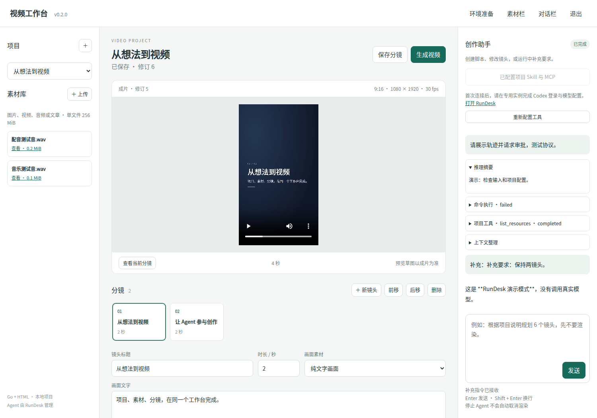
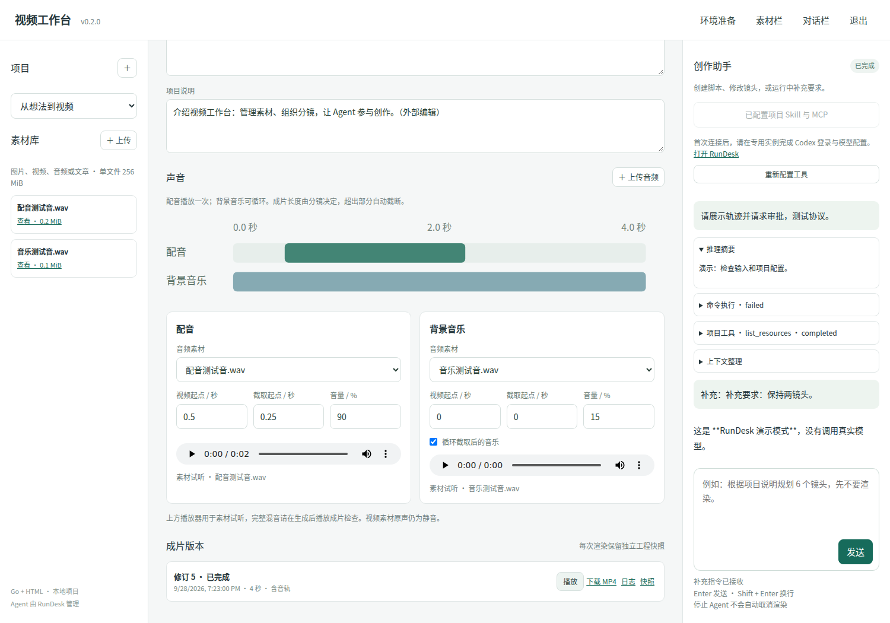
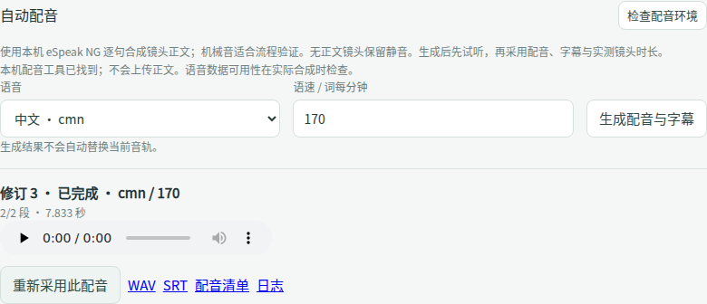
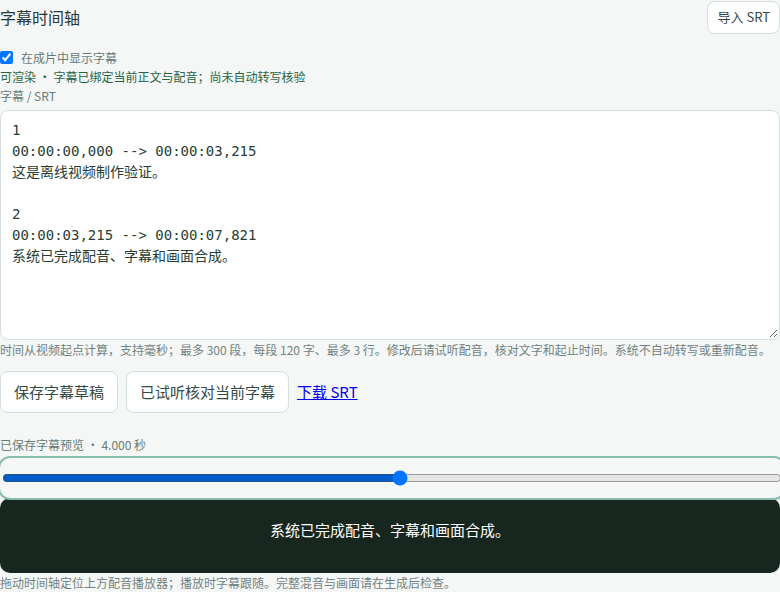

# RunDesk Video App · v0.6.0

一个使用 **Go + HTML/CSS/原生 JavaScript** 的本地视频工作台。通过 RunDesk HTTP API 使用 Codex；项目、素材、分镜和渲染任务由视频 App 管理。

本仓库是独立 App 原型，不改变 RunDesk 的通用定位。暂用工作名称“视频工作台”。主程序只使用 Go 标准库，页面嵌入二进制。渲染器是独立安装的 HyperFrames CLI；它需要 Node.js、Chrome 和 FFmpeg。

v0.6.0 要求 RunDesk 0.15.0+。连接时自动登记应用，复用旧实例和会话，初始能力由 RunDesk 安装；重连不重写后台配置。新增 HTTP MCP，模型、Skills、MCP、Docker 在 RunDesk 中管理。参见 [本次升级](docs/APPLICATION-CONNECT.md)。





## 本机自动配音

v0.5.0 可从当前分镜正文生成 eSpeak NG 预览配音，并按真实音频样本生成分句字幕和逐镜头时长。任务可取消、保留进度与日志；完成后试听并采用，不覆盖生成期间的新编辑。机械音适合流程验证，尚未接入高自然度配音和逐字对齐。



详见 [配音使用、安装与接口](docs/SPEECH.md) 和 [v0.5 验证记录](docs/VALIDATION-0.5.md)。examples/tts-app.mp4 为本 APP 自动配音后生成的真实示例。

## 配音与字幕时间轴

v0.4.0 可直接采用新闻原片的 WAV/SRT，调整镜头总长；支持字幕导入、编辑、配音试听定位、人工核对和渲染烧录。改正文、换配音或移动音轨后会提示重新核对，避免旧字幕进入新成片。原片采用的镜头切点仍需人工检查；新版本可为改稿生成本机预览配音。



详见 [字幕使用与接口](docs/SUBTITLES.md) 和 [v0.4 验证记录](docs/VALIDATION-0.4.md)。examples/subtitled-app.mp4 是配套演示经本 APP 重新渲染的 1080×1920 / 30 fps 成片。

## 新闻工作台接入

v0.3.0 可导入 news2douyin 已审核脚本制作包，保留原稿、审核记录和来源证据；可接收同一稿件版本的成片 ZIP，播放原始视频并下载 WAV/SRT。RunDesk 配置的 MCP 新增 `video_news_get`，让 Agent 读取这些依据后修改制作草稿。

导入分镜时长是估算值，原始交接成片不会随分镜编辑更新。安装 App 即可导入脚本；接收成片还需 FFprobe。只有从分镜重新渲染时才需要 HyperFrames/Node/Chrome 等依赖。

详见 [新闻交接步骤与限制](docs/NEWS-HANDOFF.md) 和 [v0.3 验证记录](docs/VALIDATION-0.3.md)。

## 当前可用

- 项目管理、素材上传、分镜编辑、镜头排序、时长和画面素材选择。
- 图片/视频/音频/文本/Markdown/PDF 上传；单文件 256 MiB。音频支持 WAV、MP3、M4A、FLAC、OGG。
- 一键在 RunDesk 创建专用实例、项目工作区、实例 Skill 和 stdio MCP 配置。
- 对话、运行中补充指令、停止 Agent、命令授权和可展开的工具记录。
- 分镜修订号检查，发现 Agent 与界面并发编辑时保留本地草稿、拒绝覆盖。
- 配音与背景音乐双音轨、视频起点、素材截取起点、0–200% 音量、背景音乐循环和素材试听。
- 独立后台渲染任务、取消任务、版本快照、日志、MP4 播放与下载。
- 固定竖版 1080×1920 / 30 fps 模板，使用真实 HyperFrames 渲染及 FFprobe 检查。

**v0.2 支持上传配音和背景音乐并混音输出。** 视频素材原声保持静音；未选音轨时输出无声视频。每个镜头 1–60 秒，最多 80 个镜头，总长不超过 10 分钟。一次运行一个渲染任务。v0.5 支持本机预览 TTS；尚无神经网络音色、逐字强制对齐、自由时间线、多模板、自定义 HTML 双向编辑、断点续渲染和多人权限。

## 安装

按 [Ubuntu 安装指南](docs/UBUNTU.md) 准备依赖，然后运行：

```bash
chmod +x bin/video-app scripts/*.sh
./scripts/setup-renderer.sh
# RunDesk 开启令牌验证时，先设置同一个 RUNDESK_TOKEN。
./scripts/start.sh
```

打开 http://127.0.0.1:3220 。默认登录令牌位于 `data/access-token`；也可以提前设置至少 24 个字符的 `VIDEO_APP_TOKEN`。RunDesk 默认在 3210 端口。

从旧版本升级请先阅读 [升级说明](docs/UPGRADING.md)，保留原数据目录，并在项目中更新工具配置。

新建项目 → 连接 RunDesk → 在 RunDesk 的“视频制作 App”实例完成 Codex 登录/模型配置 → 添加素材 → 对话规划分镜 → 配置音轨 → 保存 → 生成视频。

**新实例不复制其他实例的凭据。** 单击“已配置”仅表示 Skill/MCP 配置已写入，不能代替 Codex 登录，也不能保证每个外部工具已启动。原生运行和复杂交互的完整诊断仍在 RunDesk 页面。

## 开发

需要 Go 1.25+：

```bash
go test -race ./...
./scripts/build.sh
./bin/video-app --version
```

没有 npm 前端构建。`runtime/package-lock.json` 固定渲染工具依赖，安装使用 `npm ci`。运行时通过 HyperFrames 官方环境开关关闭遥测。

- [音轨使用说明](docs/AUDIO.md)
- [架构与接口](docs/ARCHITECTURE.md)
- [验证记录与限制](docs/VALIDATION.md)
- [依赖说明](THIRD_PARTY.md)

MIT License。渲染器、字体和其他外部依赖遵循各自许可。
