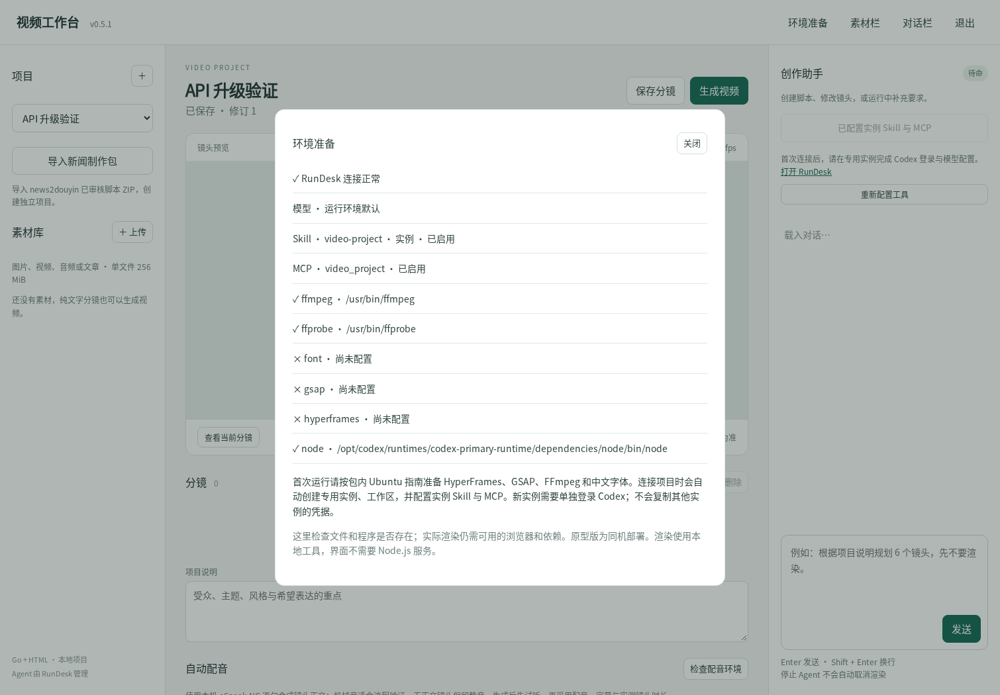
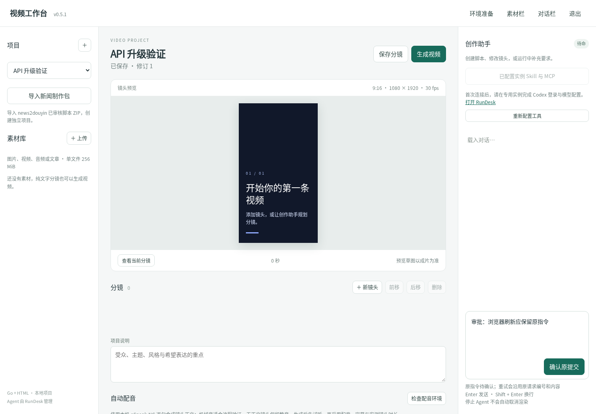

# v0.5.1 验证记录

- Go `go test -race -v ./...`：31 个测试及 1 个示例通过；1 项真实 eSpeak 配音检查因未设置 VIDEO_TEST_ESPEAK 跳过。未发现竞态，日志在 rundesk-v1/go-tests.log。
- 新增检查：响应丢失与进程重建、不可变请求体、processing/unconfirmed/失败回执不重新执行、回执认证失效保持待确认、消息恢复、重复编号冲突、停止与追加指令运行归属检查、停止待确认任务不得启动它、迟到回执到达后继续停止原运行。
- 实际 RunDesk 0.6.1 演示二进制联调覆盖实例 Skill 配置、会话来源、丢失启动响应后重启 Video App 只恢复原运行；两应用共同联调 13 项通过。
- Chromium 页面检查：配置可见，连接失败后刷新保留原请求，重试保留原正文与编号，停止携带原运行编号，无 JavaScript 异常。
- 既有 Go 测试继续检查新闻交接、音轨、字幕、修订冲突、媒体范围请求、授权和旧项目字段兼容；本轮未再次生成真实 TTS/HyperFrames 示例视频。
- Linux amd64 构建及实际启动通过；Windows amd64 仅交叉编译，未实机运行。

测试使用 RunDesk --demo，无真实 Codex 模型或外部搜索；配置已保存不等于真实工具已被模型成功调用。旧版演示视频和验证记录继续保留，日期/版本以各自记录为准。





## 联调复现

需要 Python 的新闻应用依赖、requests、Node、Playwright 和 Chromium。设置 BROWSER_BIN、CODEX_PRIMARY_RUNTIME_NODE、CODEX_PRIMARY_RUNTIME_NODE_MODULES；字体可通过 FONTCONFIG_FILE 指定。两个服务由同一测试进程启动，测试数据使用临时目录。

```bash
python scripts/integration_rundesk_v1.py --rundesk /absolute/path/rundesk --news /absolute/path/news2douyin --video /absolute/path/video-app --output /tmp/rundesk-v1-check
```

视频包对应脚本位于 scripts/integration_rundesk_v1.py。测试连接真实 RunDesk 0.6.1 二进制的 --demo 环境，不发起真实模型或外部搜索。新闻生产代码仍拒绝 demo；只有测试客户端覆盖 meta.demo，用于验证协议格式。
